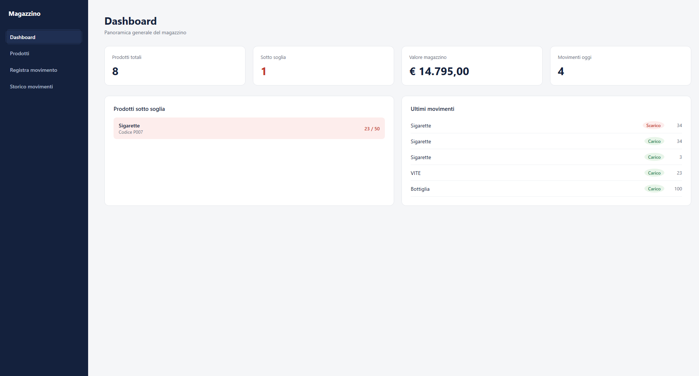
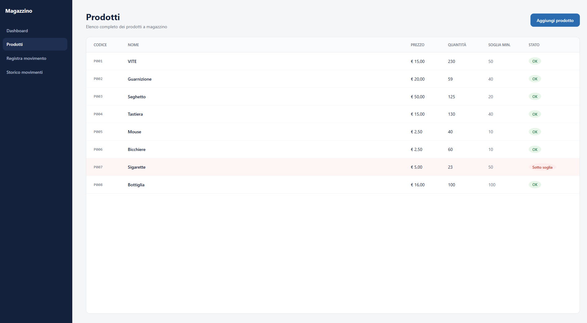
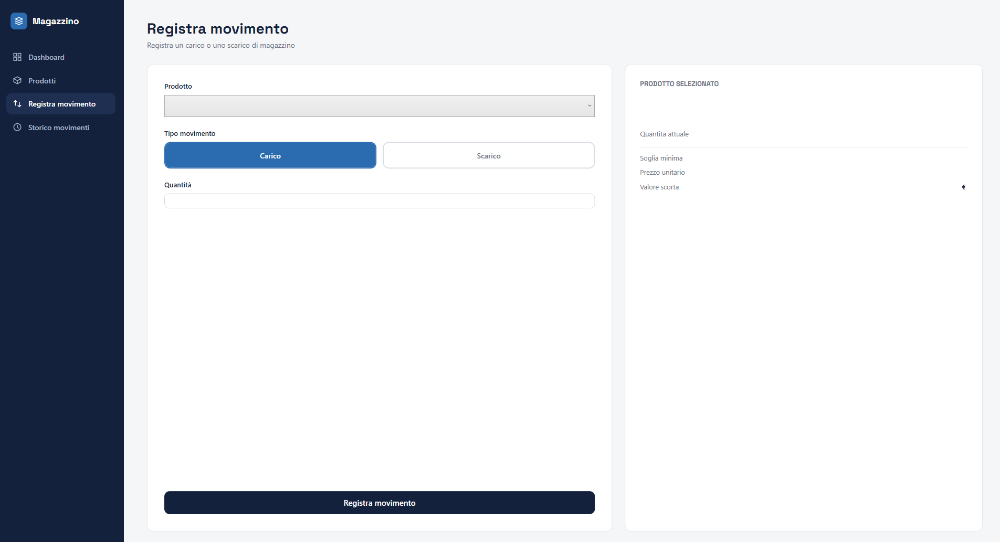
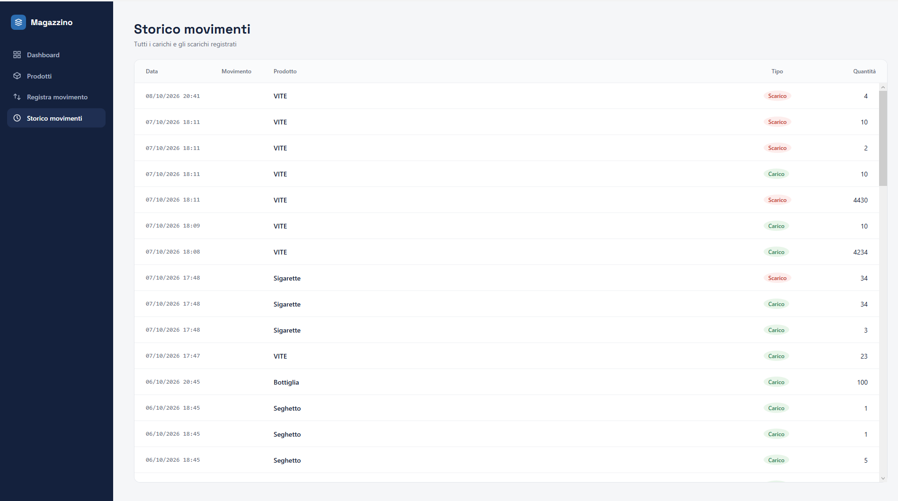

# Gestione Magazzino

Applicazione per la gestione di un magazzino: prodotti, movimenti di carico e scarico, controllo delle scorte minime. La logica sta in una libreria condivisa da due interfacce, una console e una desktop in WPF. I dati sono salvati in **SQL Server**.



## Funzionalità

- **Dashboard**: numero di prodotti, prodotti sotto soglia, valore totale del magazzino, movimenti del giorno, elenco dei prodotti sotto soglia e ultimi movimenti.
- **Prodotti**: tabella di tutti i prodotti con lo stato della scorta (OK / Sotto soglia) e inserimento di un nuovo prodotto.
- **Registra movimento**: carico o scarico di un prodotto, con un pannello che mostra quantità, soglia, prezzo e valore della scorta aggiornati in tempo reale.
- **Storico movimenti**: tutti i movimenti registrati, dal più recente.
- **Avvisi**: conferma del movimento registrato e avviso quando un prodotto scende sotto la soglia minima.
- **Controlli sui dati**: codice prodotto duplicato, prezzo e quantità non validi, scorta insufficiente per uno scarico.
- **Più postazioni**: console e WPF lavorano sullo stesso database, anche contemporaneamente.

| Prodotti | Registra movimento | Storico movimenti |
|---|---|---|
|  |  |  |

## Tecnologie

- C# / .NET 10
- WPF con pattern MVVM
- SQL Server (LocalDB in sviluppo), accesso ai dati con **ADO.NET** (`Microsoft.Data.SqlClient`)
- Configurazione con `appsettings.json` (`Microsoft.Extensions.Configuration`)
- Test automatici con **xUnit**prima 
- Nullable reference types attivi

## Struttura della soluzione

```
GestioneMagazzino.sln
├── database/schema.sql        Script che crea le tabelle Prodotti e Movimenti
├── GestioneMagazzino.Core     Libreria con tutta la logica: modelli, servizio, repository, eventi, eccezioni
├── GestioneMagazzino          Interfaccia console (menu testuale)
├── GestioneMagazzino.Wpf      Interfaccia desktop (Views, ViewModels, Commands)
└── GestioneMagazzino.Tests    Test automatici (xUnit)
```

Il progetto è nato come applicazione console con salvataggio su file JSON. Per aggiungere l'interfaccia grafica ho spostato la logica in una libreria separata (`Core`), così console e WPF la condividono senza duplicare codice. In seguito ho sostituito i file JSON con SQL Server.

## Scelte tecniche

**Repository dietro interfacce.** `ServizioMagazzino` contiene tutte le regole e non sa dove finiscono i dati: riceve nel costruttore due interfacce, `IProdottiRepository` e `IMovimentiRepository`. Nell'applicazione le realizzano `SqlProdottiRepository` e `SqlMovimentiRepository`, nei test due repository finti in memoria.

**SQL scritto a mano con ADO.NET.** Ho scelto ADO.NET invece di Entity Framework per scrivere io le query e capire cosa succede sotto un ORM: connessioni, query parametrizzate (contro la SQL injection), lettura dei risultati, transazioni.

**Transazione sui movimenti.** Registrare un movimento sono due operazioni: aggiornare la scorta del prodotto e inserire il movimento. Le eseguo in un'unica transazione: se una fallisce, il rollback annulla anche l'altra.

**Controllo della scorta atomico.** Il controllo "la scorta basta?" è nella `WHERE` dell'`UPDATE` (`QuantitaAttuale + @variazione >= 0`). Controllo e aggiornamento sono un'unica istruzione, quindi due postazioni non possono scaricare la stessa merce. Se l'`UPDATE` non modifica nessuna riga, il repository lancia `ScortaInsufficienteException`.

**Regole anche nel database.** Lo schema ha chiave primaria sul codice prodotto, chiave esterna dai movimenti ai prodotti e vincoli `CHECK` (prezzo positivo, scorta mai negativa, quantità del movimento positiva). Id (`IDENTITY`) e data del movimento (in UTC) li genera il database.

**Composition root e configurazione.** Solo un punto per applicazione sceglie le classi concrete: `Program.Main` nella console e `App.OnStartup` in WPF. Leggono la stringa di connessione da `appsettings.json`, creano i repository SQL e li passano al servizio. Per cambiare database basta modificare il file, senza ricompilare.

**MVVM scritto a mano.** Non ho usato librerie MVVM: `ViewModelBase` (con `INotifyPropertyChanged`) e `RelayCommand` (con `ICommand`) sono scritti da me, per capire cosa fanno prima di affidarmi a un framework. La navigazione tra le pagine usa un `ContentControl` collegato al ViewModel corrente e un `DataTemplate` per ogni coppia ViewModel/View.

**Eventi.** Il servizio pubblica due eventi, `MovimentoRegistrato` e `ScortaBassa`. La console li usa per stampare un messaggio, il ViewModel per mostrare conferma e avviso a video. Il servizio non sa chi lo ascolta.

**Disiscrizione dagli eventi.** I ViewModel vengono ricreati a ogni cambio pagina, mentre il servizio vive quanto l'applicazione. Un ViewModel iscritto a un evento resterebbe in memoria e continuerebbe a rispondere anche dopo essere stato sostituito. Per questo il ViewModel implementa `IDisposable` e si disiscrive quando la pagina cambia.

**Validazione su più livelli.** Il ViewModel controlla il formato (campo vuoto, testo che non è un numero). Il servizio controlla le regole di business (codice duplicato, prezzo o quantità non validi) e le segnala con eccezioni, alcune personalizzate (`ScortaInsufficienteException`, `ProdottoGiaEsistenteException`). Il database, infine, rifiuta comunque i dati che violano i numero). Il servizio controlla le regole di business (codice duplicato, prezzo o quantità non validi) e le segnala con eccezioni, alcune personalizzate (`ScortaInsufficienteException`, `ProdottoGiaEsistenteException`). Il database, infine, rifiuta comunque i dati che violano i vincoli.

## Test

20 test xUnit, che non richiedono il database:

- **`ProdottoTests`**: quantità iniziale, valore della scorta, soglia minima (con `[Theory]`, compreso il caso limite quantità = soglia).
- **`ServizioMagazzinoTests`**: inserimento, codice duplicato, prezzo e quantità non validi, carico e scarico, scarico oltre la scorta (che non deve modificare niente), eventi `MovimentoRegistrato` e `ScortaBassa`.

Il servizio viene testato con `FakeProdottiRepository` e `FakeMovimentiRepository`, che rispettano le stesse interfacce dei repository SQL ma tengono i dati in memoria. Ogni test parte da repository vuoti.

## Come eseguirlo

Requisiti: Windows, .NET 10 SDK e SQL Server LocalDB (installato con Visual Studio, carico di lavoro "Archiviazione ed elaborazione dati").

```
git clone https://github.com/Aamonsd/gestione-magazzino.git
cd gestione-magazzino
```

**1. Crea il database**

```
sqlcmd -S "(localdb)\MSSQLLocalDB" -Q "CREATE DATABASE GestioneMagazzino"
sqlcmd -S "(localdb)\MSSQLLocalDB" -d GestioneMagazzino -i database/schema.sql
```

In alternativa, da Visual Studio: Esplora oggetti di SQL Server → crea il database `GestioneMagazzino` → apri ed esegui `database/schema.sql`.

Attenzione: `schema.sql` cancella e ricrea le tabelle, quindi rieseguirlo elimina tutti i dati.

**2. Controlla la connessione**

La stringa di connessione è in `appsettings.json`, sia in `GestioneMagazzino` sia in `GestioneMagazzino.Wpf`:

```json
{
  "ConnectionStrings": {
    "Magazzino": "Server=(localdb)\\MSSQLLocalDB;Database=GestioneMagazzino;Trusted_Connection=True;TrustServerCertificate=True;"
  }
}
```

Con LocalDB e l'autenticazione di Windows non serve cambiarla.

**3. Avvia**

Interfaccia desktop:

```
dotnet run --project GestioneMagazzino.Wpf
```

Interfaccia console:

```
dotnet run --project GestioneMagazzino
```

Test:

```
dotnet test
```

## Sviluppi futuri

- Metodi asincroni (`OpenAsync`, `ExecuteReaderAsync`) per non bloccare l'interfaccia durante le query
- Contenitore di dependency injection di .NET al posto della creazione manuale degli oggetti
- Gestione dei fornitori (il modello `Fornitore` esiste già)
- Una Web API con ASP.NET Core sopra la stessa libreria `Core`
 

